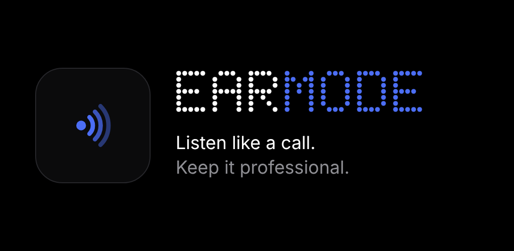
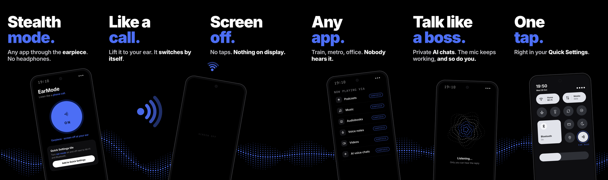

  

<h3 align="center">Listen like a call. Keep it professional.</h3>

  <b>Coming soon to Google Play</b> · Android 10+

---

  

## What it does

Forgot your headphones? **EarMode** sends the sound of any app to your phone's earpiece, the small speaker you use for calls, the moment you lift the phone to your ear. Move it away and it's back on the speaker. Automatically, just like a phone call or a voice note.

- **Like a call.** Lift it to your ear and the sound switches to the earpiece by itself.
- **Screen off.** The screen goes black at your ear. No accidental taps, nothing on display.
- **Any app.** Music, podcasts, audiobooks, voice notes, videos. On the train, the metro or at the office, nobody else hears it.
- **Talk like a boss.** Private AI voice chats. The mic keeps working, and so do you.
- **One tap.** Turn it on from the icon or the Quick Settings tile. Close the app and your sound goes back to normal.

## Privacy

No ads. No accounts. No data collected. EarMode works fully offline. Read the [privacy policy](https://g-oza.github.io/earmode/privacy.html).

## Status

EarMode is in closed testing. Want early access? Open an issue or get in touch and I'll add you as a tester.

---

Made in Munich · Minimal black, one sapphire accent.

